# Execução do Super Prompt — MVP FIB-T para a ISG no VitalOS

## Status da avaliação

- Modo: auditoria, arquitetura e planejamento.
- Instrumento considerado: Escala de Felicidade Interna Bruta do Trabalhador — FIB-T.
- Recomendação: GO para desenvolvimento em staging com dados sintéticos.
- Produção e coleta real: NO-GO temporário.
- Nenhum deploy, push, merge, migration em produção, importação real ou envio de convites está autorizado.

# 1. Veredito executivo

O VitalOS possui uma base tecnológica suficientemente madura para transformar a FIB-T em um MVP real sem construir sistema paralelo. A plataforma já possui organizações, perfis, ondas, convites, Supabase, RLS, dashboards, FlorêncIA, engines e registries.

Entretanto, a implementação FIB-T encontrada precisa ser corrigida antes de qualquer pesquisa real.

Bloqueios principais:

1. definição digital do instrumento divergente do documento;
2. escala de respostas não reproduz integralmente as âncoras originais;
3. índice 0–1000 e faixas classificatórias não documentadas;
4. possível relação entre convite individual e resposta;
5. link setorial sem persistência setorial adequada;
6. dashboard demonstrativo/mock e agregação não específica da FIB-T;
7. licença e manual complementar pendentes;
8. produção, backup e restauração ainda precisam ser comprovados.

# 2. Estrutura metodológica do documento

O documento apresenta:

- 32 itens;
- escala de 0 a 4;
- três fatores;
- nove domínios;
- escore bruto como soma das médias dos três fatores.

## Fator 1 — Padrão de Vida

Itens:

1, 2, 6, 8, 16, 17, 18, 21, 23, 25, 27 e 32.

Domínios:

- Padrão de Vida;
- Educação;
- Cultura.

## Fator 2 — Bem-Estar

Itens:

7, 9, 10, 11, 14, 15, 19, 22, 24, 28, 30 e 31.

Domínios:

- Bem-Estar Emocional/Psicológico;
- Saúde;
- Uso do Tempo;
- Vitalidade Comunitária;
- Meio Ambiente.

## Fator 3 — Satisfação com a Empresa

Itens:

3, 4, 5, 12, 13, 20, 26 e 29.

Domínio:

- Governança.

# 3. Escala correta

| Valor | Âncora |
|---:|---|
| 0 | Discordo totalmente |
| 1 | Discordo parcialmente |
| 2 | Não concordo e nem discordo |
| 3 | Concordo parcialmente |
| 4 | Concordo totalmente |

O formulário digital deve preservar essas âncoras.

# 4. Cálculo documentado

```text
Fator 1 = soma das respostas dos 12 itens / 12
Fator 2 = soma das respostas dos 12 itens / 12
Fator 3 = soma das respostas dos 8 itens / 8

Escore bruto FIB-T = Fator 1 + Fator 2 + Fator 3
```

Cada fator varia de 0 a 4. O escore bruto varia de 0 a 12.

O índice 0–1000 e as faixas “frágil”, “em desenvolvimento”, “saudável” e “florescente” devem ficar bloqueados até existir fundamento metodológico explícito.

# 5. Divergências metodológicas a confirmar no código

A auditoria identificou divergências de associação de itens a fatores ou domínios, incluindo os itens 2, 5, 6, 9, 18 e 24.

Consequências:

- distribuição incorreta entre os fatores;
- resultados não equivalentes ao instrumento;
- dashboard potencialmente incorreto;
- necessidade de manifesto canônico e testes.

# 6. Anonimato e privacidade

O documento apresenta o questionário como anônimo e informa que a identificação pessoal não será registrada.

O desenho atual de convites deve ser auditado para impedir que e-mail, token ou identificador do convite possam ser ligados à resposta.

Arquitetura recomendada:

```text
Convite:
email ou referência de distribuição
→ token_hash
→ cohort_id
→ status

Resposta:
wave_id
→ cohort_id
→ instrument_version
→ answers
```

A resposta não deve armazenar `invite_id`, e-mail, token original ou chave correlacionável.

# 7. Distribuição recomendada

Modalidade preferencial:

- links individuais;
- uso único;
- gerados em lote por setor;
- token armazenado como hash;
- expiração;
- revogação;
- acompanhamento apenas de participação;
- setor copiado para a resposta sem identidade individual.

Link setorial compartilhado deve ser apenas alternativa secundária. Preferir códigos anônimos individuais por setor.

# 8. Arquitetura alvo

```mermaid
flowchart LR
    PA[Administrador VitalOS] --> ENG[Engagement ISG]
    ENG --> ORG[Organização ISG]
    ORG --> SET[Setores]
    ORG --> WAV[Onda FIB-T]

    SET --> DIST[Distribuição]
    WAV --> DIST
    DIST --> INV[Convites ou códigos]
    INV --> PAR[Participante]

    PAR --> FLO[FlorêncIA]
    FLO --> RPC[Submissão atômica]

    RPC --> INV
    RPC --> RESP[(Respostas anônimas)]
    SET --> RESP

    RESP --> SCO[Engine FIB-T]
    SCO --> AGG[Agregação]
    AGG --> PRI[Privacy Gate]
    PRI --> SNAP[(Snapshot)]
    SNAP --> DASH[Dashboard]
    SNAP --> EXP[PDF e CSV]
```



# 9. Narrativa personalizada recomendada

Eixo:

“Prosperidade humana como infraestrutura da inovação responsável.”

## Institucional

FIB-T ISG 2026 — Escuta humana para inovação responsável.

## Participante

Sua experiência importa. Não existem respostas certas ou esperadas. Os resultados serão apresentados somente de forma agregada, com proteção para grupos pequenos.

## Tecnológica

Dados protegidos. Escuta qualificada. Decisões responsáveis.

# 10. Cadastro da ISG sem billing

Contrato conceitual:

```text
organization_mode = managed_client
engagement_type = fib_t_pilot
billing_requirement = not_applicable
entitlement_source = manual_contract_or_partnership
entitlement_status = active
authorized_instrument = fib_t
authorized_waves = 1
self_service_purchase = false
```

O provisionamento deve ser administrativo, auditável, reversível e compatível com billing futuro.

# 11. Contrato do MVP

## Incluído

- provisionamento da ISG;
- uma onda FIB-T;
- setores;
- convites individuais;
- códigos por setor;
- FlorêncIA conversacional;
- 32 itens;
- escala original;
- três fatores;
- nove indicadores de domínio;
- dashboard agregado;
- comparação setorial protegida;
- PDF e CSV agregados;
- auditoria;
- RLS;
- testes E2E;
- backup e restauração;
- simulação sintética.

## Excluído

- billing;
- checkout;
- LLM generativo;
- benchmark externo;
- ranking;
- score individual;
- diagnóstico;
- certificação;
- previsão de produtividade;
- recomendações automatizadas.

# 12. Backlog prioritário

| ID | Entrega | Prioridade |
|---|---|---:|
| FIBT-001 | Confirmar licença e manual | P0 |
| FIBT-002 | Manifesto canônico | P0 |
| FIBT-003 | Corrigir engine | P0 |
| FIBT-004 | Bloquear mocks no modo real | P0 |
| FIBT-005 | Engagement gerenciado ISG | P0 |
| FIBT-006 | Estrutura setorial | P0 |
| FIBT-007 | Convite sem vínculo com resposta | P0 |
| FIBT-008 | FlorêncIA conversacional | P0 |
| FIBT-009 | Agregador FIB-T | P0 |
| FIBT-010 | Privacy Gate | P0 |
| FIBT-011 | Dashboard específico | P0 |
| FIBT-012 | Exportação governada | P1 |
| FIBT-013 | E2E e acessibilidade | P0 |
| FIBT-014 | Produção, backup e restore | P0 |
| FIBT-015 | Simulação completa | P0 |

# 13. Plano em ondas

## FIBT-0 — Verdade metodológica

- confirmar fonte e licença;
- criar manifesto;
- corrigir autoria e definição;
- remover interpretações não autorizadas;
- criar testes canônicos.

## FIBT-1 — Corte vertical sintético

- organização sintética;
- setor;
- onda;
- convite;
- submissão;
- cálculo;
- visualização.

## FIBT-2 — ISG e coortes

- engagement;
- organização;
- perfis;
- setores;
- importação.

## FIBT-3 — Anonimato e distribuição

- hash de token;
- uso único;
- resposta sem vínculo;
- códigos setoriais.

## FIBT-4 — FlorêncIA

- avatar autorizado;
- interface;
- escala;
- acessibilidade;
- neutralidade.

## FIBT-5 — Resultados

- scoring;
- agregação;
- supressão;
- dashboard;
- exportação.

## FIBT-6 — Release Candidate

- JWT;
- RLS;
- E2E;
- acessibilidade;
- performance;
- backup;
- restore;
- revisão LGPD.

## FIBT-7 — Piloto controlado

Somente após autorização humana específica.

# 14. Condições de NO-GO

- licença incerta;
- fórmula não aprovada;
- produção não identificada;
- backup não comprovado;
- RLS incompleta;
- identidade ligada à resposta;
- ausência de supressão;
- migration divergente;
- comunicação enganosa sobre IA;
- avatar sem autorização;
- impossibilidade de teste completo.

# 15. Decisões humanas pendentes

1. Existe autorização formal de uso e digitalização da FIB-T?
2. Existe manual complementar com missing data e interpretação?
3. Quantos participantes e setores existem?
4. Qual modalidade de distribuição será utilizada?
5. Quem são controlador, operador e responsáveis metodológico e de privacidade?

# 16. Recomendação final

GO imediato para:

- correção metodológica;
- manifesto;
- implementação em staging;
- dados sintéticos;
- arquitetura de anonimato;
- dashboard específico;
- FlorêncIA determinística;
- narrativa da ISG.

NO-GO temporário para:

- pessoas reais;
- convites reais;
- coleta real;
- produção;
- índice 0–1000;
- faixas classificatórias;
- afirmação de anonimato antes da correção;
- LLM generativo.
