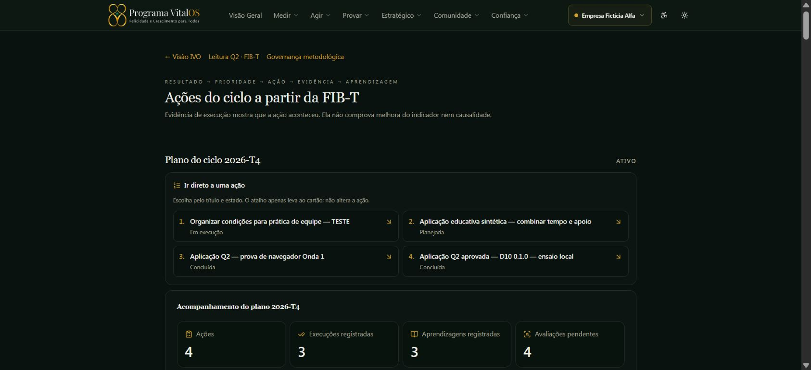

# Q2 — navegação acessível entre ações e revisão visual residual

Data: 16/11/2026. Base `576c464fc434b512c2ccaf272aa548e3a8a0ed80`, branch `feat/ivo-fibt-platform-foundation`, sem alterações rastreadas prévias. `.q.out` e `.q.sql` preservados, sem leitura ou alteração.

## Problema e implementação

A tentativa de concluir a captura do cartão aprovado confirmou a extensão do plano: em 320 px, o cartão tem aproximadamente 3.810 px de altura e começa após mais de 12 mil px de conteúdo. Os formulários continuam necessários, mas localizar uma ação pelo scroll é custoso. A captura de viewport retornou quadro vazio; a captura por região suportada retornou timeout. Isso não é prova de defeito de renderização do produto.

Implementado **“Ir direto a uma ação”**, no início de cada plano não vazio, com título e estado das ações já autorizadas, na ordem existente. Links nativos apontam para os IDs dos títulos; os títulos agora recebem foco programático por fragmento, com margem para o cabeçalho e indicação de foco. Não foi acrescentado callback de escrita, filtro de dados, organização, persona, armazenamento ou decisão metodológica. Não há atalhos vazios em plano sem ações.

Escolha técnica: links internos sobre a estrutura existente preservam formulários e rascunhos. Ocultar cartões com acordeão acrescentaria estado e risco de interromper edição; paginação exigiria contratos maiores. A alteração fecha uma necessidade de localização sem condicionar sua utilidade à ferramenta de captura.

Arquivos de produto/teste:

- `src/components/ivo/FibtActionLoop.tsx`: índice nativo com ícones decorativos e alvos de pelo menos 44 px; títulos focáveis com IDs existentes.
- `src/components/ivo/IvoJourney.test.tsx`: dois testes de destinos, estados, foco potencial, ausência de comandos de escrita e plano vazio.
- `src/components/ivo/PlanComposition.test.tsx`: teste de ordem passou a comparar os cartões semânticos, evitando confundir o título repetido no índice com o cartão. O painel de encerramento continua antes dos cartões e o formulário de inclusão depois deles.

## Prova local efetivamente executada

O harness somente leitura validou API `http://127.0.0.1:57621`, banco em 57622, container `supabase_db_vitalos-institutional-first-admin` e identidade de projeto antes do login. App em `http://localhost:8091`. Um link foi solicitado para `alfa@institutional.test`, recebido no Mailpit local e consumido pelo fluxo normal. Sem sessão administrativa, setup/reset, migration, nova conta ou e-mail externo.

A página mostrou a aplicação aprovada existente, versão 0.1.0, estado Concluída, uma execução e uma aprendizagem. O índice exibiu as quatro ações do plano. Em **320 e 360 px**, o atalho acionado por **Enter** colocou o fragmento e o foco no título `acao-3a798020-37f7-488c-9a5a-d56113e214bd`, correspondente ao cartão aprovado. Em 360 px, client width e scroll width foram ambos 340 px. Não houve envio de ação, mudança de estado ou registro de evidência. O resumo permaneceu com quatro ações, três execuções e três aprendizagens. Viewport original restaurado.

[Prova sanitizada de navegador](artifacts/Q2_ACTION_NAVIGATION_BROWSER_2026-11-16.json) · [Fontes/cópia compilada](artifacts/Q2_ACTION_NAVIGATION_SOURCES_2026-11-16.json).

Captura desktop real do índice no plano institucional Alfa:

## Verificação do candidato

- Testes direcionados dos componentes: **53 pass, 0 fail, 259 asserções**.
- Gate integrado: **4.381 pass, 0 fail, 346 arquivos, 13.686 asserções**.
- Paridade, TypeScript e secret-scan aprovados.
- Build inerte aprovado em `.institutional-admin.local/module-build-1794821847066`; `.output` preservada. Três arquivos finais de fonte/teste conferidos por SHA-256 contra a cópia compilada, todos idênticos.
- Lint semântico dos três arquivos aprovado, com aviso de Fast Refresh sobre constantes exportadas já existentes. Formatação legada não foi reescrita; não se declara lint global verde. Revisão de diff aprovada.

Primeiro teste dirigido teve 52 aprovações e uma falha: o teste antigo procurava a primeira ocorrência textual do título, que agora também aparece no índice. A verificação de posição foi corrigida para usar os artigos reais, sem remover o contrato de ordem. O gate final inclui a correção. A suíte emitiu aviso EPERM de leitura de diretório do Bun, mas saiu com código zero e os totais acima. Não se ampliaram permissões de leitura para eliminar o aviso.

Comandos: `bun --no-env-file test src/components/ivo/IvoJourney.test.tsx src/components/ivo/PlanComposition.test.tsx`; gate equivalente `bun --no-env-file test src scripts`, paridade, `node node_modules/typescript/bin/tsc --noEmit`, secret-scan; build `bun --no-env-file scripts/institutional-module-inert-build.ts`. Nenhuma prova HTTP/DB/concorrência anterior foi repetida: os contratos de persistência não mudaram.

## Limite de captura e pacote de piloto

**A captura mobile detalhada do cartão continua não confirmada por pixels.** Resultados observados: viewport com quadro vazio; região de página com `Timed out after 5000ms waiting for CDP command Page.captureScreenshot`; uma captura mobile do índice também teve timeout. A captura desktop válida, o foco e a navegação por fragmento não substituem essa prova. O procedimento de troubleshooting e as APIs documentadas foram usados, sem desativar validação ou permissões. A janela nativa disponível não estava identificada como a página de teste; não se capturou conteúdo alheio para suprir a evidência.

Roteiro manual residual: entrar no ambiente descartável, abrir o plano Q2 em 320/360 px, usar **Ir direto a uma ação → Aplicação Q2 aprovada**, conferir título, origem, execução/aprendizagem e foco, sem enviar registros. O atalho reduz a necessidade de percorrer todo o plano. Não é necessário repetir as provas de persistência.

O pacote de revisão de piloto criado em `576c464` foi preservado como snapshot do candidato de produto `517c206`. Seu `--check` continua válido para os 31 arquivos selecionados; **não cobre este incremento de navegação nem prova a totalidade do checkout atual**. A revisão do próximo candidato deve considerar também este registro, os três hashes e o diff posterior. Não se reescreveu a evidência histórica nem se atribuiu novo escopo ao pacote antigo.

D10 0.1.0, fonte Q1, D9, vínculos ESG e papéis permanecem nas decisões existentes. Testes e build são locais; CI/staging, experiência assistiva completa, eficácia, piloto real e prontidão comercial não foram confirmados. Sem push, deploy, migration ou escrita remota.

**Próximo marco único:** registrar as decisões PIL-01–PIL-08 sobre o piloto Q2, incluindo a escolha explícita do candidato, com o pacote base e este incremento disponíveis para revisão. A indisponibilidade da captura detalhada está documentada com roteiro residual; não se aguarda indefinidamente uma recuperação presumida da ferramenta.
