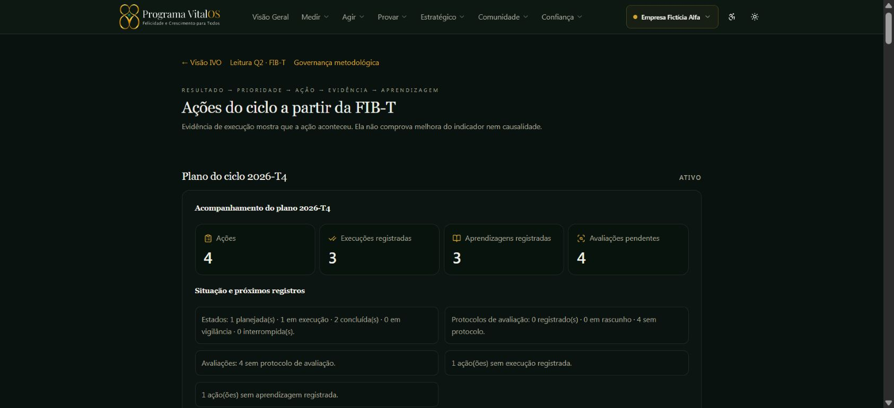

# Q2 D10 · prova funcional local da unidade e atividade aprovadas

Fechamento: 2026-11-16. Base: `84fa2d2`, branch `feat/ivo-fibt-platform-foundation`, sem alterações rastreadas anteriores. Revisão editorial de ambas as revisoras em 15/11/2026 preservada. **Prova funcional de navegador concluída; captura visual mobile incompleta.** Sem homologação comercial, científica ou remota.

## Alvo e preservação

O helper `institutionalEnv` validou API `http://127.0.0.1:57621`, DB `127.0.0.1:57622`, container `supabase_db_vitalos-institutional-first-admin` e `project_id` correspondente antes da interação com escrita. App `http://localhost:8091`; Mailpit `http://127.0.0.1:57624`. As quatro portas estavam acessíveis. Não se presumiu banco local pela disponibilidade do Docker.

Reutilizados stack descartável já existente, empresa Alfa, seu administrador sintético, ciclo `2026-T4`, plano ativo e onda `a339451f-7642-4ed1-b629-e1ad6f42ec86`. Nenhum setup, reset, migration, seed, duplicação de organização, nova coleta, republicação, alteração de módulo ou operação remota.

Baseline anterior à aplicação: **3 ações e 4 evidências** nas empresas sintéticas Alfa/Beta. Após a prova: **4 ações e 6 evidências**. O painel de Alfa mostra 4 ações, 3 registros de execução e 3 de aprendizagem. O incremento é uma ação, uma execução e uma aprendizagem; registros anteriores e módulos permaneceram iguais.

| Empresa | Q1 | Revisão | Q2 | Revisão |
| --- | --- | ---: | --- | ---: |
| Alfa | Desligado | 44 | Ligado | 87 |
| Beta | Desligado | 9 | Desligado | 13 |

Esses estados foram comparados antes/depois, sem alterná-los. As provas anteriores de desabilitação em sessão aberta e autorização continuam válidas; não foram repetidas por não haver mudança de implementação que as invalidasse.

## Jornada efetivamente percorrida

1. Abrir a rota de ações com a sessão institucional Alfa já existente. Confirmar plano, fonte publicada e catálogo atualizado. Abrir **“Aprender com dificuldades de trabalho sem expor pessoas”**, versão `0.1.0`, com fonte TRU-006, claim `CLAIM-EDMONDSON1999-Q2-001` e aviso explícito de ensaio local.
2. Confirmar recuperação mental antes das alternativas. Responder uma alternativa inadequada e conferir feedback sobre associação versus causalidade. Responder as demais; o formulário de aplicação continuou ausente até a escolha explícita de compartilhamento.
3. Usar **“Revisar sem consulta”**: alternativas, seleções e opt-in foram removidos; a recuperação inicial voltou. Nenhuma ação foi criada por responder ou revisar.
4. Em viewport mobile de 360 px efetivos, reabrir as questões, responder e ativar compartilhamento pelo teclado. Confirmar origem Bem-Estar/Equipe sintética e destino no plano existente. Preencher e confirmar pelo produto a aplicação **“Aplicação Q2 aprovada — D10 0.1.0 — ensaio local”**, com função responsável sintética, prazo 22/11/2026 e indicador de execução “Acordo coletivo preparado: 0 → 1 acordo”.
5. A aplicação criada guarda referência da unidade `0.1.0` e ID/versão da atividade aprovada, sem prefixo TESTE. Alterar somente essa ação para “Em execução”. Registrar uma execução e, separadamente, uma aprendizagem vinculada à unidade aprovada; os relatos dizem explicitamente que se trata de ensaio sintético, sem encontro com clientes reais.
6. Concluir operacionalmente somente essa ação. Sua rastreabilidade passou a uma execução e uma aprendizagem; **eficácia permaneceu não avaliada**. Nenhum protocolo/parecer D9, dimensão IVO ou impacto ESG foi produzido. O plano ficou ativo, com as outras ações em seus estados anteriores.
7. Recarregar a página em 320 px efetivos: aplicação concluída persistida, respostas pedagógicas reiniciadas. Não houve inclusão adicional após a recarga.
8. Sair pelo menu da conta institucional. Ao tentar a rota protegida novamente, o produto apresentou **“Entrar com link mágico”**. Solicitar login de `alfa@institutional.test`, abrir a mensagem nova no Mailpit e usar o link, conferindo em memória a origem `http://127.0.0.1:57621/auth/v1/verify` e o callback `http://localhost:8091/auth/callback`. Nenhuma sessão foi gerada administrativamente; tokens/links não foram salvos em evidência.
9. Após o novo login, a conta exibiu Empresa Fictícia Alfa. Retornar à rota: uma única aplicação aprovada, uma execução, uma aprendizagem, eficácia não avaliada e zero respostas pedagógicas selecionadas. Mailpit fechado e viewport restaurado; página institucional deixada disponível ao usuário.

ID sintético da nova ação: `3a798020-37f7-488c-9a5a-d56113e214bd`. Origem FIB-T `1.0.0`, fator `bem_estar`; não se copiou valor do resultado para a aplicação. As outras três ações não foram concluídas, interrompidas ou reescritas durante esta prova.

## Persistência e isolamento em processo independente

Novo script [institutional-approved-learning-readback.ts](../../scripts/institutional-approved-learning-readback.ts), com alvo restrito pelo helper existente:

- `--baseline`: registra módulos e hashes dos registros sintéticos anteriores. Recusa sobrescrever a baseline existente.
- Sem flag: consulta o estado e autentica Alfa/Beta por login normal com credencial pública, sem sessão administrativa. Verifica a aplicação por título, referências, origem, status e escopos de evidência; Beta não enxerga o item nem suas evidências pelo PostgREST/RLS. As sessões criadas para releitura são encerradas com escopo local, sem encerrar outras sessões do mesmo usuário.
- SQL usado somente para comparação de hashes/contagens no alvo validado; nenhuma escrita SQL, mudança de schema ou cadastro. A prova de RLS usa o cliente autenticado de cada usuário, sem service role como identidade de leitura.

**12 verificações aprovadas:** módulos/revisões preservados; ações/evidências anteriores preservadas; Beta sem nova ação; uma aplicação visível à Alfa; referências corretas sem TESTE; origem publicada; dois escopos de evidência; ledger sem respostas/gabarito/nota; conclusão operacional; isolamento RLS; incremento de uma ação e duas evidências. As garantias de concorrência/retry transacionais permanecem respaldadas pelas provas anteriores e testes do candidato; a interface desta etapa enviou uma inclusão, sem repetir artificialmente a prova de concorrência.

Evidência sanitizada versionada: [Q2_D10_LOCAL_READBACK_2026-11-16.json](artifacts/Q2_D10_LOCAL_READBACK_2026-11-16.json). Baseline e resultado detalhado locais em `.institutional-admin.local/q2-d10-browser-baseline.json` e `q2-d10-browser-readback.json`; sem credenciais. A proteção de sobrescrita foi exercitada: recusa esperada e SHA-256 da baseline preservado.

## Mobile, teclado e captura visual

O override de viewport foi ajustado pela dimensão CSS efetivamente observada, porque a primeira configuração de 360 retornou 480 px efetivos no navegador. Nenhum zoom ou preferência persistente do usuário foi alterado.

| Largura CSS observada | Área cliente | Scroll width | Resultado |
| ---: | ---: | ---: | --- |
| 360 | 340 | 340 | Sem overflow horizontal; questões, feedback, opt-in e formulário utilizados pelo teclado |
| 320 | 300 | 300 | Sem overflow horizontal após recarga; aplicação persistida e zero respostas selecionadas |

As medidas são de layout vivo, não de uma simulação HTML externa. A primeira tentativa de `check()` por ponteiro em viewport reduzido não alterou o rádio; a entrada pelo teclado funcionou. O preenchimento inicial de prazo com `fill()` não reteve o valor; o controle nativo suportado `setValue` reteve `2026-11-22`, com validade confirmada antes do envio. Esses episódios não motivaram alteração de código por suposição.

As capturas de viewport reduzido retornaram quadros vazios ou **`Timed out after 5000ms waiting for CDP command Page.captureScreenshot`**. Foram consultados os procedimentos suportados de desenvolvimento local e troubleshooting, sem modificar validação de URL, permissões ou mecanismos de segurança. Após restaurar o viewport e concluir o novo login, a captura desktop voltou a funcionar. Uma tentativa de recorte do item também teve timeout; não se declarou homologação visual mobile nem se usou quadro vazio como prova de design.

Captura desktop sanitizada do painel após a nova aplicação:

Roteiro manual curto para completar a revisão por pixels: abrir a rota de ações no ambiente local, localizar o título da aplicação acima, expandir a unidade aprovada e conferir 320/360 px no navegador; revisar quebra de texto, legibilidade, foco e alcance dos controles. Usar a revisão do exercício e opt-in sem enviar outra aplicação. As provas funcionais e de persistência já concluídas não precisam ser refeitas.

## Observação de entrada e próximo incremento

Na página pública, **“Entrar no app”** abriu a demonstração restrita por senha. A janela foi fechada, sem senha de demo ou fallback demonstrativo; a rota institucional protegida conduziu ao login normal e foi usada na prova. O contraste entre os destinos merece uma entrada institucional explícita para reduzir a ambiguidade de quem já contratou o serviço.

**Próximo incremento técnico único:** tornar a entrada institucional clara na página pública, preservando o acesso próprio da demonstração e os contratos de autenticação existentes. A captura mobile por pixels segue com o roteiro acima; ela não impede essa melhoria independente. Piloto com clientes, publicação e uso remoto continuam dependendo de autorização específica.

## Verificação e arquivos

Nenhum arquivo de `src/` mudou. O gate de **4.339 testes**, TypeScript, paridade e build de `84fa2d2` continuam válidos e não foram repetidos. Para o novo harness: execução real da baseline/releitura, 12 verificações, recusa de sobrescrita, Prettier, ESLint, secret-scan e revisão de diff aprovados.

Arquivos deste fechamento: este registro; `scripts/institutional-approved-learning-readback.ts`; evidência JSON e captura JPG acima; atualização do checkpoint e do marco no dossiê D10. Sem push, deploy, e-mail externo, conta real, migration ou alteração metodológica. `.q.out` e `.q.sql` não foram abertos ou alterados.

## Adendo de fechamento posterior — entrada institucional e cobertura do harness

A entrada pública foi implementada e comprovada no incremento seguinte: [registro](LANDING_INSTITUTIONAL_ACCESS_2026-11-16.md). O próximo incremento indicado acima está concluído; o novo próximo passo único é revisar `/entrar` e a recuperação de link mágico.

Correção da abrangência da evidência anterior: o gate histórico de 4.339 testes não havia exercitado a descoberta estática do novo script de releitura. O gate seguinte detectou a ausência de registro na família local e da chamada direta ao guard. O helper já verificava o alvo local; foram adicionados `requireInstitutionalLocalTarget` explícito antes de consultas e o registro correspondente, sem bypass ou mudança de SQL. Gate final seguinte: 4.346 aprovados, zero falhas. As 12 verificações DB deste registro continuam válidas para o cenário executado; não foram repetidas.
